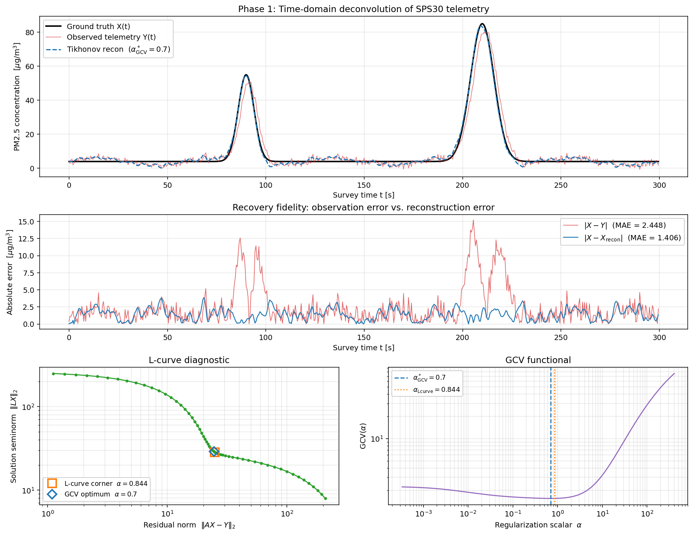

# pm25-deconvolution

**Recovering where airborne pollution actually was, not where a slow sensor said it was.**

Phase 1 signal-recovery engine for **PS2-26**, a fixed-wing UAV that maps hyperlocal PM2.5 concentration across urban survey areas.

> **Scope:** This repository covers Phase 1 only: time-domain deconvolution of the raw sensor stream. Airframe design, avionics, and Phase 2 geostatistical interpolation are owned by other members of the project team. See [Team and scope](#12-team-and-scope).

---

## Results at a glance

Validated end-to-end against synthetic ground truth, a digital twin where the correct answer is known exactly. Seed 42, fully reproducible.

| Metric | Raw sensor output | After deconvolution | Improvement |
| --- | --- | --- | --- |
| Mean absolute error | 2.448 µg/m³ | 1.406 µg/m³ | 1.74× |
| Root mean squared error | 3.655 µg/m³ | **1.637 µg/m³** | **2.23×** |

The smoothing strength is chosen automatically. Two methods built on unrelated principles agree to within 21%, inside a search space spanning six orders of magnitude:

| Method | Principle | α selected |
| --- | --- | --- |
| Generalized cross-validation | Minimize out-of-sample prediction error | 0.6996 |
| L-curve corner | Maximize curvature of the fit-vs-smoothness trade-off | 0.8441 |

Wind is recovered from GPS ground speed alone, with **no airspeed sensor**. On a synthetic lawnmower flight carrying a true 3.00 m/s along-track wind at 7.30 m/s airspeed, the engine recovered **3.00 m/s** and **7.29 m/s**.



---

> **A note on the numbers**
>
> The airframe is still in construction, so every aircraft-derived figure in this document (cruise speed, and therefore the spatial lag, the survey timings, and the sample counts) is a **working estimate supplied by the airframe team**, not a measured value. They will be replaced with real numbers once the aircraft is built and the first survey is flown.
>
> **This does not affect the engine.** Every one of those quantities is a configuration variable, not a hardcoded assumption. The mathematics (convolution, Tikhonov regularization, GCV selection, leg segmentation) depends on the *structure* of the problem, not on any particular value. Change the cruise speed, the time constant, the logging rate, or the survey geometry, and the engine reconfigures: it derives Δt from the telemetry itself, sizes the convolution matrix accordingly, converts time-based thresholds into sample counts at ingest, and selects a fresh regularization strength for every segment.
>
> The one number that is **not** provisional is the recovery performance, because it was measured against synthetic ground truth where the correct answer is known by construction. The 2.23× figure does not depend on the aircraft, but it does depend on the test conditions (the synthetic signal, the noise level, and the 0.5 s sampling interval), so it will differ on real telemetry.
>
> Values currently provisional: the sensor time constant ($\tau$, working figure 2 s), cruise speed (8–13 m/s, working figure 10), spatial lag ($\tau v$, working figure 20 m), survey line spacing (~20 m), altitude (~12 m AGL), and the altitude reference datum.

---

## Contents

1. [What this project is](#1-what-this-project-is)
2. [The problem](#2-the-problem)
3. [How it works: the intuition](#3-how-it-works-the-intuition)
4. [How it works: the math](#4-how-it-works-the-math)
5. [Pipeline architecture](#5-pipeline-architecture)
6. [Execution modes](#6-execution-modes)
7. [Input and output schema](#7-input-and-output-schema)
8. [How to run](#8-how-to-run)
9. [Design decisions and trade-offs](#9-design-decisions-and-trade-offs)
10. [Limitations and current status](#10-limitations-and-current-status)
11. [Roadmap](#11-roadmap)
12. [Team and scope](#12-team-and-scope)

---

## 1. What this project is

Cities publish air quality data, but usually from a handful of fixed monitoring stations, sometimes only one for an entire municipality. That tells you the average, and averages hide the thing people actually breathe day to day. Pollution at street level varies enormously over tens of metres: a busy intersection, a bus depot, a construction site, a sheltered courtyard. None of that shows up in a citywide number.

**PS2-26** is a student-built fixed-wing UAV designed to fill that gap.

### The aircraft

| Property | Value |
| --- | --- |
| Configuration | Fixed wing, high wing, conventional tail, tricycle gear |
| Gross mass | 1.4222 kg |
| Wing area | 0.4651 m² |
| Construction | FDM-printed lightweight ASA |
| Autonomy | ArduPlane + Mission Planner |
| Payload | Sensirion SPS30 particulate sensor + Arduino Nano |

### The mission

| Property | Value |
| --- | --- |
| Survey area | 1000 m × 1000 m |
| Flight pattern | Lawnmower (boustrophedon): parallel legs, alternating direction |
| Line spacing | ~20 m |
| Altitude | ~12 m AGL, held roughly constant |
| Cruise speed | ~10 m/s *(provisional, see [Limitations](#10-limitations-and-current-status))* |

A 1 km survey area at 20 m line spacing means roughly **50 parallel legs**, each 1 km long, each taking about 100 samples at the SPS30's 1 Hz sampling rate. The aircraft flies up one leg, turns, flies down the next, and repeats.

### The three phases

The full project runs in sequence, and each phase feeds the next:

| Phase | What it does | Owner |
| --- | --- | --- |
| **Phase 1** | Undo sensor lag so each reading sits at the right place, making the data usable for all future phases | **This repository** |
| Phase 2 | Turn scattered point samples into a continuous map (Ordinary Kriging) | Teammate |
| Phase 3 | Topological data analysis; wind-aware anisotropic interpolation | Future |

Phase 1 exists because of a hard rule: **you cannot fix bad coordinates downstream.** Garbage in, garbage out. If a reading is tagged with the wrong location, no interpolation method, however sophisticated, will put it back. Kriging will faithfully draw a smooth, confident, completely wrong map. Everything downstream depends on the input being spatially honest, which is what this engine delivers. No map is better than a wrong and inaccurate map.

---

## 2. The problem

### The sensor cannot forget instantly

That one sentence is the whole problem. Everything below is a consequence of it.

### The sensor is slow

The SPS30 is an optical particle counter. Air is drawn by a small fan through a chamber, a laser beam crosses that chamber, and every particle passing through the beam scatters a flash of light onto a detector (a scatter pulse). Count the flashes, size them, and you get a concentration.

The catch is the chamber. It has finite volume, and it takes time to flush. When the aircraft flies into dirty air, the chamber does not instantly fill with dirty air; the small fan has to push the old clean air out first. When it flies back out, the chamber holds onto the dirty air for a while longer.

Physically this is a **first-order response**. The concentration the sensor reports chases the true outside concentration:

$$
\tau \frac{dC_{\text{reported}}}{dt} = C_{\text{true}}(t) - C_{\text{reported}}(t)
$$

In words: the reading changes at a rate proportional to how far behind it currently is. Big gap, fast catch-up. Small gap, slow catch-up.

The constant $\tau$ ("tau") sets the timescale. This engine uses a working value of **2 seconds**. Sensirion does not publish a time constant for the SPS30, so this is an estimate that still needs to be measured on the actual sensor (see [Limitations](#10-limitations-and-current-status)). Concretely, with $\tau = 2$ s, after a sudden change the reading covers about 63% of the gap in 2 seconds, and roughly 98% of it in 8 seconds.

### Why slow matters when you are moving

A sensor sitting on a pole does not really care about $\tau$. It measures the same spot forever, so the reading eventually catches up and the answer is right.

An aircraft is different, because during those 2 seconds it has **moved**:

$$
\text{spatial lag} = v \cdot \tau
$$

At the current 10 m/s cruise estimate:

$$
10 \text{ m/s} \times 2 \text{ s} = 20 \text{ m}
$$

The reading that finally registers a plume is stamped with the GPS coordinate of where the aircraft was when the sensor caught up, about 20 m past where the plume actually was.

### Why 20 m is the worst possible number here

The survey line spacing is also about **20 m**.

That is not a near-miss. It means a plume detected on leg 12 is recorded at roughly the position of leg 13. The whole point of flying 20 m apart was to resolve features at a 20 m scale, and uncorrected sensor lag displaces every reading by exactly that distance. **The survey's designed resolution is entirely consumed by the sensor's response time.** Without correction the map would be smooth, plausible, and systematically wrong by approximately one grid cell everywhere.

It gets worse at the upper end of the cruise envelope. The airframe team's current estimate is 8–13 m/s, which spans:

| Cruise speed | Spatial lag | Versus 20 m line spacing |
| --- | --- | --- |
| 8 m/s | 16 m | 0.8 line widths |
| **10 m/s** | **20 m** | **1.0 line widths** |
| 13 m/s | 26 m | 1.3 line widths |

At 13 m/s each reading lands *more than a full line away* from where it was taken.

### What the smear actually looks like

Sensor lag does three things at once, and this matters for why the fix is not trivial:

1. **Delays** the signal: the peak arrives late
2. **Flattens** it: the peak reads lower than the truth
3. **Smears** it: a sharp plume becomes a long tail

A pure delay could be fixed by shifting the timestamps by 2 seconds. The flattening and smearing cannot. That is the actual problem this engine solves.

---

## 3. How it works: the intuition

*No equations in this section. The math is in [Section 4](#4-how-it-works-the-math). Anyone without a math background should be able to read this section and get a high-level intuitive view of the engine.*

### What the sensor is actually doing: the perfume room

Imagine a closed room with a nose-detector in it. Every second, someone sprays a different perfume.

At any given second the detector does not only smell what was sprayed that second. It smells:

- what was sprayed **this** second, at full strength
- plus **most** of last second's spray, still lingering
- plus **a bit less** of the spray from two seconds ago
- plus **even less** from three seconds ago

and so on, fading backwards into the past.

Every reading is a blend of the present and a fading memory of everything recent. Recent things count for more; older things have decayed away. The technical name for this blending is **convolution**, and it is exactly what the SPS30's chamber does to the air flowing through it.

This simplified example is worth sitting with and understanding to fully grasp everything downstream, because it explains why the problem is harder than it first appears. The sensor is not simply *late*. If it were, you could shift the timestamps back two seconds and be done. It is **mixing**: every reading is contaminated with the recent past, and no amount of shifting unmixes a blend.

### Undoing a smear is harder than it sounds

Here is the tempting idea: we know exactly how the sensor blends things, because the whole blend is described by one constant, $\tau$. So we should be able to run the blend backwards and recover the truth.

In perfect arithmetic, yes. In reality it fails, and the result is worse than the raw sensor data it started from. Understanding why is the heart of the whole project.

### Think about a blurry photograph

A blurry photo is a sharp photo that has been smeared. Software can sharpen it, and up to a point sharpening works well.

But push the sharpening slider far enough and the image explodes into speckled noise. This happens to every photo, on every piece of software, and it is not a bug.

The reason: **blurring destroys fine detail, and sharpening tries to reconstruct it.** Where the original fine detail is gone, the sharpening algorithm has nothing to work with except the sensor grain in the image, so it amplifies the grain instead, turning invisible noise into visible garbage.

Our problem works the same way. The SPS30 smears the pollution signal. Un-smearing it means amplifying fine detail. But the fine detail was destroyed, so what gets amplified is the measurement noise, and the reconstruction ends up noisier than the raw readings.

### The key idea: stop asking for the exact answer

The exact inverse is useless. So we stop asking for it.

Instead we ask a different question:

> Of all the possible pollution signals that could plausibly have produced this reading, which one is the most physically sensible?

And we know something about what "physically sensible" means in our situation. Real pollution concentrations vary over seconds and tens of seconds, the timescale of plumes, traffic, and wind. They do not flicker randomly between one sample and the next. **Real signals are reasonably smooth.**

So we search for the signal that satisfies two requirements at once:

- **Fit the data**: when you push the reconstructed data through the sensor model, it should reproduce what was actually measured
- **Be smooth**: it should not jitter wildly from sample to sample, and it should behave reasonably according to physical reality

These two requirements become the two terms of the Tikhonov equation in [Section 4.4](#44-tikhonov-regularization).

Neither alone is enough. Demand only a perfect fit and you get static. Demand only smoothness and you get a flat line that explains nothing. The answer is the best compromise, and finding that compromise is **Tikhonov regularization**, a method invented by Andrey Tikhonov for ill-conditioned inversion problems, and a perfect fit for our exact scenario.

### Turning the dial (regularization scalar)

The compromise has a dial on it. Call it α (alpha).

- Turn α **down** → prioritize fitting the data → reconstruction gets noisy
- Turn α **up** → prioritize smoothness → real peaks get flattened away
- Somewhere in between is the setting that recovers the truth best. Finding that setting is a huge component of the reconstruction problem.

Setting that dial by eye would be guesswork, and guesswork does not belong in a measurement pipeline. So the engine chooses α automatically, using a method borrowed from statistics called **cross-validation**.

The idea is the one every student already knows from studying for an exam. You could memorize the practice exam answers perfectly, but then you have learned nothing and you will fail the real test. The honest check is to cover one question, learn from the rest, and see whether you can answer the covered one.

Cross-validation does exactly that to the data: hide a measurement, reconstruct from the others, see whether the reconstruction predicts the hidden one. Whichever α predicts hidden data best is the α that has genuinely learned the signal instead of memorizing the noise.

Then, as an independent check, the engine solves the same problem a second way, by finding the point where the fit-versus-smoothness trade-off stops being a good deal. Two unrelated methods, and they agree. That agreement is the evidence the answer is real.

### Real flights break the assumptions

The math above assumes the aircraft flies at constant speed in a straight line. A real survey does not: it takes off, climbs, flies a leg, turns, flies back, and lands. Turns and speed changes break the relationship between time and distance that the whole correction depends on.

So the engine splits the flight into **legs** (the straight, steady stretches of flight) and corrects each one independently. Turns, climbs, and speed excursions are excluded and marked as such. The output says "no answer here" rather than inventing an inaccurate one.

---

## 4. How it works: the math

This section builds the engine from first principles. Each step is logically forced by the one before it.

### 4.1 Building the sensor as a matrix (A)

Sample the world at a fixed interval $\Delta t$. The worked examples below use $\Delta t = 0.5$ s, the simulation's rate; in flight the SPS30 delivers 1.0 s. Nothing in the derivation depends on which, so the engine accepts any $\Delta t$. Two vectors of length $N$:

- $X \in \mathbb{R}^N$: the **true** concentration at each instant. What we want.
- $Y \in \mathbb{R}^N$: the **measured** concentration. What the input CSV contains.

Solving the first-order ODE from Section 2 for a single instantaneous puff gives the sensor's **impulse response**:

$$
h(t) = e^{-t/\tau}, \qquad t \ge 0
$$

The sensor is a **linear system**: the response to a sum of puffs is the sum of the responses. So decompose $X$ into a puff at every sample, and the reading at time $i$ is the sum of every past puff weighted by how long ago it happened:

$$
Y_i = \sum_{j=0}^{i} X_j \, e^{-(i-j)\Delta t/\tau}
$$

That sum is a matrix-vector product. Define

$$
A_{ij} = \begin{cases} e^{-(i-j)\Delta t/\tau} & j \le i \\ 0 & j > i \end{cases}
$$

and the entire sensor collapses to

$$
Y = AX
$$

**What a single entry means.** It is worth reading $A_{ij}$ on its own, because it makes the whole matrix legible:

> $A_{ij}$ = *of whatever arrived at time $j$, what fraction of it is still left at time $i$.*

That is all the matrix is. Every entry is a survival fraction, and every row is a recipe for one reading.

**One row, written out.** Let $r = e^{-\Delta t/\tau}$ be the fade factor per time step. Row 3, the fourth reading, expands to:

$$
Y_3 = X_3 \cdot 1 \; + \; X_2 \cdot r \; + \; X_1 \cdot r^2 \; + \; X_0 \cdot r^3
$$

| Term | What it means |
| --- | --- |
| $X_3 \cdot 1$ | what just arrived, all still there |
| $X_2 \cdot r$ | last step's arrival, faded once |
| $X_1 \cdot r^2$ | two steps ago, faded twice |
| $X_0 \cdot r^3$ | three steps ago, faded three times |

The perfume room from Section 3, in arithmetic. Each successive term is the previous one multiplied by $r$, which is exactly what "the memory fades geometrically" means.

$A$ has two structural properties, each with a physical meaning:

- **Lower triangular**: row $i$ touches only columns $j \le i$. This is *causality*, the sensor cannot be affected by pollution it has not encountered yet.
- **Toeplitz**: entries are constant along each diagonal. This is *time invariance*, a plume at $t = 10$ s is smeared exactly like an identical plume at $t = 200$ s.

**What $A$ does to the truth, in one sentence.** $A$ smears the truth forward in time. Every sharp spike acquires a fading tail, and the tails pile on top of one another. The readings come out blurrier, lagging behind, and, when the true signal is falling, sometimes *higher* than reality, because the chamber is still holding onto richer air from a moment ago.

### 4.2 Row normalization and mass conservation

Raw exponential weights sum to more than 1, which would inflate every reading. Concretely, at steady state a true concentration of 10 µg/m³ would come out as roughly 45 µg/m³, inflated by a factor of about 4.5.

The fix is one line:

```python
A /= A.sum(axis=1, keepdims=True)
```

Dividing each row by its own sum normalizes every row to 1, removing the inflation that the all-positive weights would otherwise produce.

Every row now sums to exactly 1, so each reading is a **weighted average of recent true values, heavily weighted toward the present, tapering into the past.** Constant input maps to identical constant output. This is mass conservation at steady state.

One consequence: the first few rows have less history to average, so they are not fully populated. For roughly $4\tau/\Delta t = 16$ samples the sensor is still equilibrating after power-on. This **transient regime** is physically real and the engine accounts for it rather than hiding it.

### 4.3 Why direct inversion fails

$A$ is invertible, lower triangular with positive diagonal, so the determinant is nonzero. The naive solution $X = A^{-1}Y$ exists.

It is also useless, and the reason is the single most important idea in this repository. Basic foundational knowledge of Fourier analysis helps here, but a quick high-level base is enough: any signal can be represented as a sum of high-frequency waves (fast oscillating sine waves) and low-frequency waves (slow oscillating sine waves), in its own unique recipe, called its **frequency spectrum**.

**$A$ is a low-pass filter.** Averaging is smoothing. A slow-varying signal survives averaging almost unchanged; a fast oscillation largely cancels itself out within the averaging window. So $A$ passes low frequencies and shrinks high ones. In singular-value terms, at $\Delta t = 0.5$ s, $A$'s singular values $\sigma_i$ run from about 1.28 for the slowest modes down to about 0.12 for the fastest, a condition number of about 10.

**Therefore $A^{-1}$ is a high-frequency amplifier.** If $A$ multiplies the fastest mode by about 0.12, then $A^{-1}$ multiplies it by about 8.

**And noise lives at high frequency.** Thermal noise, electronic hash, and quantization all look like fast random jitter.

Put those together. The real measurement is $Y = AX + \varepsilon$, so:

$$
A^{-1}Y = A^{-1}(AX + \varepsilon) = X + \underbrace{A^{-1}\varepsilon}_{\text{amplified}}
$$

On the simulation data this is not a small effect. Direct inversion gives an RMSE of 6.535 µg/m³, **worse than the raw sensor output** (3.655 µg/m³), while Tikhonov regularization (below) gives 1.637 µg/m³. Undoing the smear naively leaves the data in worse shape than doing nothing at all.

The underlying continuous problem is **ill-posed**: the high-frequency content of $X$ was shrunk by the sensor until it is buried under noise, and no amount of arithmetic precision brings back information that is not there. The discrete version is ill-conditioned, and it gets worse the finer you sample: the condition number is about 4.9 at $\Delta t = 1.0$ s, about 10 at 0.5 s, and grows without bound as $\Delta t \to 0$.

### 4.4 Tikhonov regularization

Since we cannot recover the high-frequency content, we stop trying to, and penalize it instead:

$$
X_{\text{recon}} = \arg\min_X \underbrace{\lVert AX - Y \rVert_2^2}_{\text{fit the data}} + \alpha \underbrace{\lVert LX \rVert_2^2}_{\text{stay smooth}}
$$

- The **first term** is the sum of squared errors between what the model predicts and what was measured.
- The **second term** penalizes roughness, scaled by α.
- **α** trades between them. Zero recovers the disaster above (it fits the data but is too jagged to be realistic); infinity returns a flat line (perfectly smooth, but it no longer fits the data).

This tension has a name: the **bias–variance trade-off**. Too little regularization and the reconstruction has low bias but enormous variance, chasing every noise fluctuation. Too much and variance collapses but bias takes over, flattening real plume peaks along with the noise. The same trade-off governs every regularized estimation problem in statistics and machine learning, which is why the tooling for choosing α transfers directly from those fields.

In the singular-value picture (shown here for the simplest case, $L = I$), Tikhonov replaces the amplification factor $1/\sigma_i$ with $\sigma_i/(\sigma_i^2 + \alpha)$. For large $\sigma_i$ (the well-conditioned slow modes) this is still approximately $1/\sigma_i$, so nothing useful is lost. For small $\sigma_i$ (the noise-dominated fast modes) it becomes approximately $\sigma_i/\alpha$, which is small. **The amplification is suppressed where it does the most damage, and left alone elsewhere.** With the first-difference $L$ used in this engine, the same picture holds in the generalized SVD of the pair $(A, L)$.

*Also known as ridge regression in statistics, or $L_2$ regularization in machine learning.*

### 4.5 The smoothness operator L

$L$ is the $(N-1) \times N$ first-difference matrix (multiplying $L$ by $X$ produces the vector of differences between consecutive samples of the proposed reconstruction):

$$
L = \begin{bmatrix} -1 & 1 & & \\ & -1 & 1 & \\ & & \ddots & \ddots \end{bmatrix}, \qquad LX = \begin{bmatrix} X_1 - X_0 \\ X_2 - X_1 \\ \vdots \end{bmatrix}
$$

so $\lVert LX \rVert_2^2 = \sum_i (X_{i+1} - X_i)^2$ measures the total jaggedness of the reconstruction.

**Why first differences and not the identity?** Because of the null space. $LX = 0$ requires every consecutive difference to vanish, which means $X$ is constant:

$$
\mathcal{N}(L) = \text{span}\lbrace \mathbf{1} \rbrace
$$

The penalty is therefore **invariant under adding a constant**: $\lVert L(X + c\mathbf{1}) \rVert = \lVert LX \rVert$. The regularizer literally cannot see the baseline concentration, so the ambient level is set by the data alone and does not drift as α increases.

With $L = I$ (standard ridge) the null space is trivial, so every reconstruction is shrunk toward zero by an amount that grows with α. For a pollution measurement that is a systematic under-report: it reports cleaner air than reality, with the bias proportional to how much smoothing you applied.

**Choosing $L$ is choosing what you refuse to penalize.** First differences declare the baseline free.

The quadratic form $L^\top L$ is the tridiagonal discrete Laplacian, whose eigenvalues are

$$
\lambda_k = 2\left(1 - \cos\frac{k\pi}{N}\right)
$$

Zero for the constant mode, growing monotonically with frequency, maximal for the fastest mode. That is a rigorous statement that the penalty is a high-pass filter: it charges exactly the modes that inversion would have blown up.

### 4.6 Solving it

The objective is a convex quadratic in $X$. Setting the gradient to zero:

$$
\left(A^\top A + \alpha L^\top L\right) X = A^\top Y
$$

These are the **regularized normal equations**, "normal" in the geometric sense of *perpendicular*, since the unregularized version states that the residual is orthogonal to the column space of $A$.

The system matrix $G = A^\top A + \alpha L^\top L$ is symmetric and positive definite for any $\alpha > 0$:

$$
v^\top G v = \lVert Av \rVert^2 + \alpha \lVert Lv \rVert^2 > 0 \quad \text{for } v \ne 0
$$

Positive definite means the Hessian is positive definite, the objective is strictly convex, and the solution is the **unique global minimum**. No local minima, no initialization sensitivity, no iteration: one linear solve gives the exact answer.

```python
return np.linalg.solve(AtA + alpha * LtL, Aty)
```

### 4.7 Choosing α automatically: GCV

Choosing α by best fit to the data always selects α → 0, which is the original disaster. Fitting the measurement is not the goal; **predicting unseen data** is.

**Leave-one-out cross-validation** does that honestly: remove point $i$, fit on the rest, check the prediction at $i$, repeat for all $i$. Small α overfits and predicts the held-out point badly; large α underfits and also predicts badly; the minimum sits in between.

Done literally that is $N$ refits per α, which is hopeless. But the fit is **linear in the data**: fitted values are $\hat{Y} = H(\alpha)Y$ where

$$
H(\alpha) = A\left(A^\top A + \alpha L^\top L\right)^{-1}A^\top
$$

is the **hat matrix**. For any linear smoother there is an exact identity:

$$
Y_i - \hat{Y}_i^{(-i)} = \frac{Y_i - \hat{Y}_i}{1 - H_{ii}}
$$

The leave-one-out error equals the ordinary residual divided by a correction factor. One fit, no refitting. $H_{ii}$ measures how much point $i$ dragged its own fitted value toward itself; dividing it out restores the residual to what it would have been had the point not participated.

**Generalized** cross-validation replaces each $H_{ii}$ with their average $\text{tr}(H)/N$, giving

$$
\mathrm{GCV}(\alpha) = \frac{N \lVert Y - \hat{Y} \rVert^2}{\left(N - \mathrm{tr}\,H\right)^2}
$$

This is rotation-invariant (ordinary CV is not) and carries an asymptotic optimality result from Golub, Heath and Wahba (1979).

The quantity $\text{tr}(H)$ is the **effective degrees of freedom**. For ordinary least squares with $p$ parameters it equals $p$ exactly; under regularization it is fractional, measuring how many parameters the model is effectively using. It runs from $N$ at $\alpha = 0$ down to $1$ as $\alpha \to \infty$. It stops at 1 rather than 0 because the constant mode sits in $L$'s null space (§4.5): it is never penalized, so it always keeps one degree of freedom.

Read the formula with that in mind and the denominator is an automatic complexity penalty. That is why α → 0 cannot win: the residual shrinks, but $\text{tr}(H) \to N$ collapses the denominator faster.

The engine minimizes over $\log\alpha$ using Brent's method, because α plausibly spans six orders of magnitude and a linear search would waste nearly every step.

**The whole argument in one line.** Each link forces the next:

> can't fit the data → must predict held-out data → leave-one-out is the honest way → leave-one-out is too slow → linearity makes it free → GCV averages the correction and gains rotation-invariance

Every GCV formula above is just the algebraic expression of one link in this chain, so the chain alone is enough to rebuild them.

### 4.8 The independent check: the L-curve

For each α, record the residual norm $\rho = \lVert AX - Y \rVert_2$ and the solution seminorm $\eta = \lVert LX \rVert_2$, and plot $\eta$ against $\rho$ on log-log axes.

The result is an L shape:

- **Vertical branch** (α too small): roughness changes enormously while the fit barely improves. Free lunches available; keep moving.
- **Horizontal branch** (α too large): the fit degrades badly while roughness barely improves. Bad deals; go back.
- **The corner**: the only place where neither pressure applies. Maximum marginal return.

The corner is located by maximizing the discrete curvature of the log-log trajectory:

$$
\kappa = \frac{x' y'' - y' x''}{\left(x'^2 + y'^2\right)^{3/2}}, \qquad x = \log\rho,\; y = \log\eta
$$

**Why this matters.** GCV is a statistical criterion (out-of-sample prediction). The L-curve is a geometric one (curvature of a trade-off frontier). They share no logic. That they land 21% apart, inside a search space spanning six orders of magnitude, is strong independent evidence that both found the genuine optimum.

GCV remains the primary selector because it carries an optimality theorem the L-curve lacks. The L-curve is the cross-check, and it specifically guards against GCV's known weakness: choosing α too small when the noise is correlated rather than white.

---

## 5. Pipeline architecture

```
PRODUCTION
  CSV  →  parse  →  validate  →  repair  →  detect legs
                                                 ↓
      cleaned CSV  ←  emit  ←  deconvolve per segment  ←  gate per leg
                                   (own A, L, α each)

SIMULATION
  synthesize X  →  smear (A)  →  add noise + drift  →  deconvolve
                                                          ↓
                                            score vs known X  →  dashboard
```

Key stages:

| Stage | Function | What it does |
| --- | --- | --- |
| Parse | `ingest_survey_telemetry` | Read CSV, normalize timestamps to $t_0 = 0$ |
| Validate | same | Five gates, see [§9](#the-validation-gates) |
| Repair | `_interpolate_short_nan_runs` | Fill dropouts ≤ 1 s, flag every one |
| Legs | `compute_track_headings`, `detect_survey_legs` | Derive heading from GPS over a 6 s window, split into straight legs |
| Gate | `find_velocity_stable_segments` | Per-leg relative velocity gating |
| Solve | `deconvolve_segmented` | Fresh $A$, $L$, and α per segment |
| Emit | `write_cleaned_csv` | Full input schema + two new columns |

A 50-leg survey produces roughly 50 independently deconvolved segments, each with its own automatically selected α, plus 49 excluded turns.

---

## 6. Execution modes

### SIMULATION: the digital twin

Generates a known ground truth, smears it through $A$, corrupts it with noise and drift, then recovers it and scores the result.

This mode exists for one reason: **it is the only place error can be measured.** On real data there is no ground truth, so "the reconstruction looks smoother" is not evidence of anything. Here the answer is known, so 2.23× RMSE improvement is a defensible number.

The synthetic signal:

| Component | Value |
| --- | --- |
| Baseline | 4.0 µg/m³ |
| Plume A | 55 µg/m³ peak at $t = 90$ s, $\sigma = 4$ s |
| Plume B | 85 µg/m³ peak at $t = 210$ s, $\sigma = 6$ s |
| Measurement noise | Gaussian, $\sigma = 1.2$ µg/m³ |
| Drift | 2.0 µg/m³ sinusoid, 60 s period |

The drift is deliberate: it is **correlated** noise, which violates GCV's white-noise assumption. Including it stress-tests the exact failure mode the L-curve cross-check exists to catch.

### PRODUCTION: real telemetry

Ingests a flight CSV, validates it, segments it, deconvolves each valid segment, and emits a spatially bound CSV for the Phase 2 handoff. No error metrics are possible. Instead, the job is to enforce the model's assumptions and be explicit about what could not be recovered.

---

## 7. Input and output schema

### Input

| Column | Unit | Notes |
| --- | --- | --- |
| `timestamp` | s or ISO 8601 | Seconds since start, or ISO datetime |
| `lat` | degrees | WGS-84 |
| `lon` | degrees | WGS-84 |
| `alt` | m | Reference datum TBD, see [Limitations](#10-limitations-and-current-status) |
| `raw_pm25` | µg/m³ | Blank cells treated as dropouts |
| `ground_speed` | m/s | GPS-derived; airspeed not required |

Sampling must be at a **constant rate**. Any rate works; it must not drift.

### Output

All six input columns preserved, plus:

| Column | Meaning |
| --- | --- |
| `cleaned_pm25` | Deconvolved concentration. **Blank** where the sample fell outside a valid segment. |
| `pm25_was_interpolated` | `1` if that row's raw reading was filled from a dropout, else `0`. |

GPS coordinates pass through **untouched**, so Phase 2 can choose its own projection.

The `pm25_was_interpolated` flag exists so the Kriging stage can downweight inferred samples in the variogram if it chooses. Provenance is preserved end to end: every number is traceable to measured, interpolated, or absent.

---

## 8. How to run

### Repository structure

```
pm25-deconvolution/
├── LICENSE                      # MIT License
├── README.md
├── pm25_deconvolution.py        # the engine (both modes + command-line interface)
├── requirements.txt             # Python dependencies
├── docs/
│   └── phase1_dashboard.png     # simulation verification dashboard
└── examples/
    ├── sample_flight.csv        # synthetic six-leg survey for trying production mode
    └── generate_sample_flight.py  # script that regenerates sample_flight.csv
```

### Install

```bash
git clone https://github.com/nihalgill/pm25-deconvolution.git
cd pm25-deconvolution
pip install -r requirements.txt
```

Requires Python 3.10 or newer, with `numpy`, `scipy`, and `matplotlib`. Tested on Python 3.10 and 3.12, with numpy 1.26 to 2.5, scipy 1.11 to 1.18, and matplotlib 3.8 to 3.11. No `pandas` dependency.

### Simulation

```bash
python pm25_deconvolution.py --mode simulation
```

Prints the console report and saves the verification dashboard to `docs/phase1_dashboard.png`. Add `--no-show` to save the figure without opening a plot window.

### Production

```bash
python pm25_deconvolution.py --mode production \
    --input examples/sample_flight.csv \
    --output cleaned_survey_data.csv
```

The included example, `examples/sample_flight.csv`, is a synthetic six-leg lawnmower flight at 10 m/s with 1 Hz logging, a 3 m/s wind, 1 m of GPS jitter, and two sensor dropouts. Running the command above on it prints:

```
  [ingest] 672 samples retained, dt = 1.0000 s (CV = 0.00e+00)
  [ingest] raw_pm25 NaN rate = 0.30%, 2 samples linearly interpolated (gap limit 1 sample(s) = 1.00 s)
  [ingest] mean ground speed = 9.73 m/s (nominal cruise 10.0 m/s)
  [legs]    6 survey leg(s) detected (heading tolerance ±10°)
  [wind]    reciprocal-leg estimate: airspeed ≈ 10.01 m/s, along-track wind ≈ 2.99 m/s
  [segment] 6 velocity-stable segment(s) isolated (±15% of each leg's median ground speed)
    segment 1: indices [0:100] (100 samples, α* = 0.3964)
    segment 2: indices [113:212] (99 samples, α* = 21.32)
    segment 3: indices [226:324] (98 samples, α* = 201.2)
    segment 4: indices [337:436] (99 samples, α* = 0.3208)
    segment 5: indices [449:548] (99 samples, α* = 403.4)
        [warn] GCV saturated at upper bound α=403.4; segment likely signal-free, reconstruction ≈ smoothed baseline
    segment 6: indices [562:661] (99 samples, α* = 403.4)
        [warn] GCV saturated at upper bound α=403.4; segment likely signal-free, reconstruction ≈ smoothed baseline
  [segment] 78 samples (11.6%) excluded: turns, transients, or velocity excursions (88.4% coverage, gate ≥50%)
  [output] wrote 672 rows to cleaned_survey_data.csv
```

Segments 1 and 4 contain the two plumes, so GCV picks a small α and keeps the detail. Segments 5 and 6 are flat baseline air, so GCV asks for maximum smoothing and flags it; that warning is expected on legs with no plume.

### Command-line options

| Flag | Default | Meaning |
| --- | --- | --- |
| `--mode` | `simulation` | `simulation` or `production` |
| `--input` | none | Input flight CSV (required for production) |
| `--output` | `cleaned_survey_data.csv` | Cleaned output CSV |
| `--figure` | `docs/phase1_dashboard.png` | Where the simulation dashboard is saved |
| `--no-show` | off | Save the dashboard without opening a plot window |
| `--tau` | 2.0 | Sensor time constant in seconds |
| `--cruise-speed` | 10.0 | Nominal cruise speed in m/s |
| `--seed` | 42 | Random seed for the simulation |

`--tau` and `--cruise-speed` override the configuration values below without editing the code, so once $\tau$ is measured on the actual sensor it can be passed straight in:

```bash
python pm25_deconvolution.py --mode production --input examples/sample_flight.csv --tau 1.8
```

Run `python pm25_deconvolution.py --help` for the full list.

### Configuration

All tunable parameters are module constants at the top of `pm25_deconvolution.py`:

| Constant | Value | Meaning |
| --- | --- | --- |
| `TAU` | 2.0 s | SPS30 clearing time constant (working estimate, not yet measured) |
| `NOMINAL_CRUISE_SPEED` | 10.0 m/s | Provisional, pending airframe finalization |
| `DT_CV_MAX` | 0.01 | Max coefficient of variation of Δt |
| `NAN_RATE_MAX` | 0.05 | Refuse above 5% missing PM2.5 |
| `GAP_MAX_SECONDS` | 1.0 s | Max interpolable dropout, = τ/2; converted to samples at ingest |
| `HEADING_TOLERANCE_DEG` | 10.0 | Heading spread defining one leg |
| `HEADING_BASELINE_SECONDS` | 6.0 s | Time span of GPS fixes used for each heading estimate |
| `LEG_VELOCITY_TOLERANCE` | 0.15 | ±15% of that leg's median speed |
| `VELOCITY_COVERAGE_MIN` | 0.50 | Minimum deconvolvable fraction |

---

## 9. Design decisions and trade-offs

### Why Tikhonov rather than a simpler inverse?

Truncated SVD (discard the small singular values and invert the rest) is the obvious alternative, and it does work. But truncation is a hard cutoff: mode 200 is kept in full and mode 201 is discarded entirely, which is a discontinuous and somewhat arbitrary decision. Tikhonov applies a smooth roll-off, $\sigma_i/(\sigma_i^2+\alpha)$ in the simplest case (§4.4), which damps gradually rather than cutting. It also admits closed-form automatic parameter selection through GCV, which truncation rank does not as cleanly.

### Why first differences rather than ridge?

Covered in [§4.5](#45-the-smoothness-operator-l). Ridge ($L = I$) has a trivial null space, so it shrinks the ambient baseline toward zero with a bias that grows with α. For a concentration measurement that is a systematic under-report. First differences put the constants in the null space and leave the baseline to the data.

Second differences were also considered. They penalize curvature rather than slope, giving a smoother result, but they over-smooth sharp plume peaks, and peak amplitude is exactly what we are trying to preserve.

### Why GCV as primary, with the L-curve as a check?

GCV has an asymptotic optimality theorem. The L-curve does not, and it is known to be ill-defined on problems where the curve has no sharp corner or several. So GCV decides.

But GCV has a documented failure mode: it can select α far too small when noise is correlated rather than white. Our synthetic data deliberately includes a low-frequency drift, which is exactly that case. The L-curve is an independent check built specifically against that weakness, and it confirms GCV behaved. It also costs almost nothing, since the α sweep was already being computed.

### Why segment on velocity rather than build a time-varying A?

A time-varying $A$ is the better idea in principle and the wrong idea in practice.

In principle it would encode the sensor response at each instantaneous speed and handle maneuvers without discarding samples. Three problems:

1. **The Toeplitz structure collapses.** Every row would need a different kernel. Each α evaluation goes from $O(N^2)$ to $O(N^3)$, and GCV becomes prohibitive.
2. **The system gets numerically sicker at low speed**, where spatial resolution degrades toward zero.
3. **Samples taken during a turn have no straight-line spatial identity to recover.** No amount of math tells you where a curved-path sample "belongs" in a straight-line model.

Segmentation cleanly separates the recoverable from the unrecoverable and flags the latter honestly. Time-varying $A$ is a research problem; segmentation is a shippable answer for our problem.

### Why per-leg relative velocity gating?

This decision avoided a $60–95 USD sensor purchase against a roughly $150 CAD airframe budget, and the free solution turned out to be better than the paid one.

**The problem.** The sensor's time constant is governed by **airspeed**, but the aircraft logs GPS **ground speed**. On a lawnmower survey those differ by the along-track wind, which reverses sign every leg. At 10 m/s cruise in a 3 m/s wind, ground speed swings between 7 and 13 m/s, a ±30% variation with no physical significance whatsoever. Gating that against a fixed constant would reject most of a perfectly good flight.

**The obvious fix** was a pitot-static airspeed sensor. Correctly specified for an aircraft this slow, that runs about $60–95 USD, which was not defensible against the airframe budget. Using ArduPilot's built-in wind estimate instead does not work either: without an airspeed sensor the estimator *assumes* a cruise airspeed and attributes the residual to wind, so recovering airspeed from it returns the assumption you started with.

**The insight.** We never needed absolute airspeed. We needed to detect airspeed *variation*. Within a single leg (fixed heading, a couple of minutes, constant altitude) the wind contribution is constant. So any ground-speed variation *inside* a leg is real.

The engine therefore:

1. Derives ground-track heading from GPS fixes across a 6 second window (a longer baseline keeps normal GPS jitter from breaking up the legs)
2. Splits the flight into legs by heading stability
3. Takes each leg's **own median** ground speed as its reference
4. Gates on deviation from that reference

Wind cancels out of the comparison entirely, and turns fall out of the leg detection for free: one mechanism solving two problems.

**A free diagnostic falls out of the geometry.** For legs flown on reciprocal headings, the along-track wind reverses while airspeed does not:

$$
\tfrac{1}{2}\left(|V_{g,A}| + |V_{g,B}|\right) = \sqrt{V_{\text{air}}^2 - w_\perp^2}, \qquad \tfrac{1}{2}\left(|V_{g,A}| - |V_{g,B}|\right) = w_\parallel
$$

The half-sum estimates airspeed; the half-difference recovers the along-track wind exactly. On a synthetic flight with true values of 7.30 m/s and 3.00 m/s, the engine reported **7.29 m/s** and **3.00 m/s**, from GPS alone.

### Why interpolate dropouts rather than drop the rows?

Two early design requirements, dropping rows with missing readings and requiring uniform sampling, turned out to be mathematically incompatible. Catching that before any real data arrived prevented a production failure.

Dropping rows seems cleaner. But the Toeplitz structure of $A$ *is* the statement that every sample is separated by an identical Δt. Delete scattered rows from a uniform time series and you create gaps, the spacing stops being uniform, and the convolution model no longer applies. On a test file with a 3% dropout rate, row-dropping pushed the Δt coefficient of variation to 0.177, seventeen times the tolerance.

So short dropouts, up to 1 second or half a sensor time constant, are linearly interpolated, which preserves the uniform time axis. Longer gaps are refused: over a full $\tau$ the signal could have done anything, and filling that would be inventing data. Every interpolated cell is flagged in the output.

The threshold is specified in **seconds, not samples**, and converted using the measured Δt at ingest. This matters because the SPS30 caps at 1 Hz while the simulation runs at 2 Hz: a fixed 2-sample limit would mean half a time constant at one rate and a full one at the other. Expressed in seconds, the physical justification holds at any logging rate.

### Why `NaN` for excluded samples rather than a fallback value?

Samples inside turns were collected where the model does not apply. We do not know their deconvolved value. Emitting `NaN` says so. Emitting a zero, or the raw reading, or an interpolation would say "here is an answer" and be lying, and a wrong pollution map that looks fine is worse than no map.

### The validation gates

Every gate enforces something the math requires. The design rule throughout: **refuse loudly rather than produce quietly-wrong output.**

| Gate | Threshold | Why |
| --- | --- | --- |
| Schema | All 6 columns | Fail fast with a readable message |
| Missing-data rate | ≤ 5% | Beyond this, too much of the "measurement" is inference |
| Dropout run length | ≤ 1 s (= τ/2) | Rate-independent; longer is fabrication |
| Sampling uniformity | Δt CV < 1% | The Toeplitz model is invalid otherwise |
| Velocity coverage | ≥ 50% deconvolvable | A flight at cruise less than half the time is a test flight |

A sixth check, mean ground speed within 0.4× to 2.5× of nominal, catches a grossly misconfigured cruise speed. It uses the **mean** rather than the median deliberately: lawnmower ground speed is bimodal (an upwind cluster and a downwind cluster), so wind cancels under averaging but not under the median, which simply selects whichever side is heavier.

---

## 10. Limitations and current status

**Status: validated on a synthetic digital twin. Production path implemented and gated. Awaiting airframe completion for field data.**

Every number in [Results](#results-at-a-glance) comes from synthetic data where the ground truth is known by construction. That is the correct way to validate an inverse method, the only setting where error can actually be measured, but it is not the same as flight validation, and no real telemetry has been processed yet.

Known limitations, in rough order of how much they matter:

**$\tau$ has not been measured on this sensor.** The whole engine rests on the time constant, and the 2 s working value is an estimate: Sensirion's datasheet does not publish one. A wrong $\tau$ means the smear is undone by the wrong amount, over-correcting or under-correcting every plume. The datasheet also lists a start-up time of 8 to 30 seconds depending on concentration, which hints that the sensor's internal averaging may not be a perfectly fixed exponential. The fix is a step-response test on the actual unit: move it quickly between clean and smoky air, log the reading, and fit the exponential. The engine takes $\tau$ as a parameter (`--tau`), so a measured value is a one-number update.

**Cruise speed is provisional.** The airframe team's current estimate is 8–13 m/s, with 10 m/s as the working figure. The spatial lag $\tau v$ scales directly with it, spanning 16–26 m across that range. Every speed-dependent number in this README will be updated when the design point is frozen. The engine itself is unaffected, as described in the note near the top.

**The simulation samples faster than the hardware can.** The digital twin runs at Δt = 0.5 s, while the SPS30's minimum measurement interval is 1 second. In flight, Δt = 1.0 s and the ratio τ/Δt = 2, so the exponential response is resolved by only two to four samples before it decays away. Coarser sampling actually makes the inversion better conditioned (a condition number of about 4.9 at 1 Hz versus about 10 at 2 Hz), but it lowers temporal resolution: features shorter than a couple of seconds cannot be resolved at 1 Hz, however good the reconstruction is. The reported metrics will be regenerated at the hardware rate once real telemetry exists. A related operational note: polling faster than 1 Hz returns repeated values, which the first-difference operator would read as artificial structure, so logging must run at exactly the sensor's native rate.

**Airspeed is not directly measured.** The velocity gate operates on GPS ground speed referenced to each leg's own median. This removes steady wind bias completely, but a *slow drift* in airspeed across an entire leg would move the median with it and go undetected. The reciprocal-leg estimate surfaces this in the diagnostic output but does not gate on it. A pitot-static sensor would remove the limitation; it was judged not worth the budget.

**Synthetic noise is not calibrated to real UAV noise.** The drift model in SIMULATION is a low-frequency sinusoid chosen as a stress test, not a measured characterization of this airframe. Real flight noise will include propeller vibration, airframe flexing, and gust response in bands this model does not represent.

**$\tau$ is treated as constant.** Valid for the fixed-altitude mission profile, where air density does not change materially. A mission with significant altitude variation would see chamber residence time, and therefore $\tau$, vary with density.

**The altitude datum is unspecified.** Altitude is passed through untouched, so the engine is unaffected, but Phase 2 will need to know whether it is GPS ellipsoidal, barometric MSL, or AGL.


---

## 11. Roadmap

**Phase 2: Geostatistical interpolation.** Ordinary Kriging over the cleaned point set to produce a continuous concentration surface. Owned by a teammate; this repository's output CSV is the handoff artifact.

**Phase 3: Advanced refinements.**

- *Topological data analysis*: Vietoris–Rips complexes over a densified grid from the Phase 2 surface, computing Betti numbers to characterize the topology of the concentration field.
- *Anisotropic Kriging*: injecting advection–diffusion physics into the Kriging weights using onboard wind data, replacing Ordinary Kriging's assumption of spatial isotropy.

**Phase 1 backlog.**

- Measure $\tau$ on the actual sensor with a step-response test
- Cholesky solve in place of LU for the SPD system (roughly 2× faster; matters if $N$ grows past ~5000)
- SVD-basis GCV evaluation to reduce per-α cost from $O(N^3)$ to $O(N)$
- Re-validation against real flight telemetry once the airframe flies

---

## 12. Team and scope

**Phase 1, time-domain deconvolution (this repository):** Nihal Gill

**Other project domains:**

| Domain | Scope |
| --- | --- |
| Mechanical systems | Airframe design, aerodynamics, intake and manifold |
| Computer systems | Telemetry logging, coordinate stamping, database |
| Physical instrumentation | Ordinary Kriging, hardware calibration |

This repository makes no claims about airframe design, sensor calibration, or the geostatistical stage. It consumes a telemetry stream and emits a spatially corrected one.

---

## References

- Tikhonov, A. N. (1963). Solution of incorrectly formulated problems and the regularization method. *Soviet Mathematics Doklady*, 4, 1035–1038.
- Golub, G. H., Heath, M., & Wahba, G. (1979). Generalized cross-validation as a method for choosing a good ridge parameter. *Technometrics*, 21(2), 215–223.
- Hansen, P. C. (1992). Analysis of discrete ill-posed problems by means of the L-curve. *SIAM Review*, 34(4), 561–580.
- Sensirion AG (2023). *Datasheet SPS30*, Version 2.0, June 2023.

---

## License

Released under the [MIT License](LICENSE). Copyright (c) 2026 Nihal Gill.
